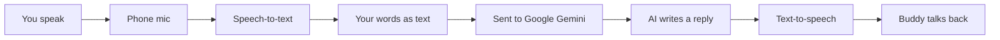

# How myMic Works — Explained for High School

*Created by Sara Han.*

*If you're presenting myMic to classmates, a club, or a teacher — this is the version to use.*

---

## What is myMic? (10 seconds)

**myMic** is a phone app that helps you **practice speaking out loud**. You get prompts to read, a friendly AI buddy to chat with, and quick mini-debates. Think of it like a **low-pressure rehearsal space** before a presentation, interview, or conversation in another language.

Built by **Sara Han**. Available on **iPhone** (App Store); **Android** version built too.

---

## The tech in one sentence

**I built one app with Flutter that uses your phone’s microphone and speakers, plus Google’s AI (Gemini), so you can talk and get a response back.**

---

## Three things the app does

### 1. My Voice — practice alone

- The app shows a **short prompt** (like “What’s your favorite hobby?”).
- You **tap record**, speak, and **hear yourself play back**.
- Sometimes the app sends your recording to **Google’s AI** so a buddy voice can **repeat what you said** — like an echo, not a rewrite.

**Real-life parallel:** Voice Memos on your phone, but with speaking prompts built in.

---

### 2. Let’s Chat — talk with Buddy

- You **speak** into the mic.
- Your phone turns speech into **text** (speech-to-text — same idea as Siri or Google Assistant).
- That text goes to **Gemini** (Google’s chat AI).
- Gemini writes a reply; the app **reads it out loud** (text-to-speech).

**Real-life parallel:** You’re texting a smart friend, except you talk instead of type, and the friend talks back.

---

### 3. Quick Debate — argue for fun

- You pick a topic and **Agree** or **Disagree**.
- You say your argument out loud.
- Gemini sends back a **playful counter-argument** so you can practice defending your point.

**Real-life parallel:** Debate club practice round, but the opponent is AI and it’s meant to be fun, not stressful.

---

## How the pieces connect (the pipeline)

When you use **Let’s Chat**, this is what happens behind the screen:



**Important honesty:** Your **voice and words leave your phone** and go to **Google’s servers** so the AI can respond. The app doesn’t have accounts or sell your data, but the privacy policy explains this clearly — same idea as using ChatGPT or Google Translate with voice.

---

## Why Flutter? (building one app for two phones)

Normally you’d write **one app for iPhone** (Swift) and **another for Android** (Kotlin) — double the work.

**Flutter** lets you write the app **once** in a language called **Dart**, and it runs on **both** iPhone and Android. One codebase, two app stores.

| Without Flutter | With Flutter |
|-----------------|--------------|
| Two separate codebases | One codebase |
| Fix a bug twice | Fix it once |
| Two designs to keep in sync | One UI |

**Tradeoff:** Flutter is great for shipping fast, but sometimes Apple-specific release issues still need extra debugging (more on that below).

---

## What’s actually on your phone vs in the cloud

| On your phone | In the cloud (Google) |
|---------------|------------------------|
| Buttons, screens, mascot | AI “thinking” and replies |
| Microphone & speaker | Understanding long voice recordings |
| Speech-to-text (often on-device) | Chat and debate responses |
| Playing back your recordings | Some audio processing for Buddy echo |

You don’t need to memorize this table — just remember: **the app is the stage; Gemini is the brain in the cloud.**

---

## Tools used (plain English)

| Tool | What it does |
|------|----------------|
| **Flutter** | Builds the whole app UI and logic |
| **Dart** | The programming language you write in |
| **Gemini** | Google’s AI that powers chat and debate |
| **Speech-to-text** | Turns your voice into words |
| **Text-to-speech** | Turns Buddy’s reply into spoken audio |
| **GitHub** | Stores the code safely (private repo) |
| **GitHub Pages** | Free website for landing page + privacy policy |
| **App Store Connect** | Where you upload the iPhone app for Apple review |
| **Transporter** | Mac app that uploads the finished `.ipa` file to Apple |

---

## Getting the app onto the App Store (not just “it works on my phone”)

Building an app for yourself is step one. **Publishing** is a whole other checklist:

1. **Apple Developer account** — you’re officially a developer.
2. **App icon & splash screen** — first thing people see.
3. **Screenshots** — marketing images for the store listing.
4. **Privacy policy** — required; explains what data the app collects.
5. **Signed release build** — Apple verifies it’s really from you (like a wax seal).
6. **Upload & review** — Apple checks the app before it goes live.

**Analogy:** Making the app is like finishing a film. The App Store process is like **ratings, posters, legal disclaimers, and the theater agreeing to show it**.

---

## Real problems I had to fix (good story for Q&A)

### “Wrong kind of build” (Transporter error)

After testing on the **iPhone Simulator** on my Mac, my upload failed because a piece of the app was built for the **simulator**, not a **real phone**. I inspected the package, cleaned everything, rebuilt, and upload **build 4** worked.

**Lesson:** Simulator testing is convenient; **real devices** matter for release.

### iPad screenshots

Apple wanted iPad screenshots because the project targeted iPad too. For version 1, I switched to **iPhone-only** — simpler than making iPad assets.

### API key safety

The AI needs a **secret key** to talk to Google. I made sure the real key **never stays in public GitHub** — rotate if leaked, use local-only config for dev.

---

## If you take CS or want to code someday

You don’t need to know all of this to *use* myMic. But if you’re curious:

- **Frontend** = what you see (screens, buttons) → Flutter widgets
- **Backend (for us: AI API)** = smart replies → Gemini over the internet
- **API** = a way for the app to ask Gemini a question and get an answer back (like ordering at a drive-through window)
- **Permissions** = the app asks “Can I use your microphone?” — iOS and Android require that

A simplified folder layout in the project:

```
lib/
  screens/     ← each main page (Home, Chat, Debate, My Voice)
  services/    ← talk to Gemini, record audio, speak replies
  widgets/     ← reusable pieces (record button, chat bubble)
```

---

## What I’d tell a class in 60 seconds

> “I built **myMic** to help people practice speaking without pressure. It’s a **Flutter** app — one codebase for iPhone and Android. You use the **mic** to talk; the phone converts speech to **text**; **Google Gemini** writes replies; the app **speaks** them back. I also shipped it to the **App Store** — privacy policy, screenshots, signing, the whole process. The hardest part wasn’t the AI — it was making sure **release builds** actually work on real phones.”

---

## Questions classmates might ask

**“Is it like ChatGPT?”**  
Similar idea — both use a large language model. myMic is **built for speaking practice**, not general homework help.

**“Does it work offline?”**  
Not fully. You need internet for AI chat and debate. Recording yourself can work more offline.

**“Did you build it alone?”**  
Yes — product decisions, code, website, and store submission. I used AI coding tools to move faster, but I tested and shipped it myself.

**“Is my voice private?”**  
Voice and text go to **Google** for AI features. No account, no selling data — but read the privacy policy if that matters to you.

---

## One-line summary

*myMic is a Flutter speaking-practice app that chains microphone → speech-to-text → Google Gemini → text-to-speech, and I took it through a real App Store release.*

---

*Shorter overview: [HOW_WE_BUILT_MYMIC_SHORT.md](./HOW_WE_BUILT_MYMIC_SHORT.md) · Interview prep: [HOW_WE_BUILT_MYMIC_DEVELOPER.md](./HOW_WE_BUILT_MYMIC_DEVELOPER.md)*
